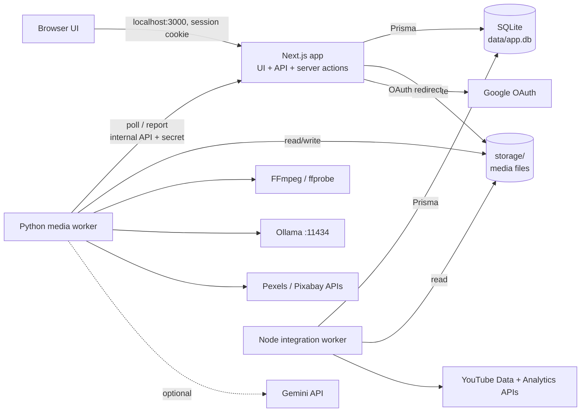
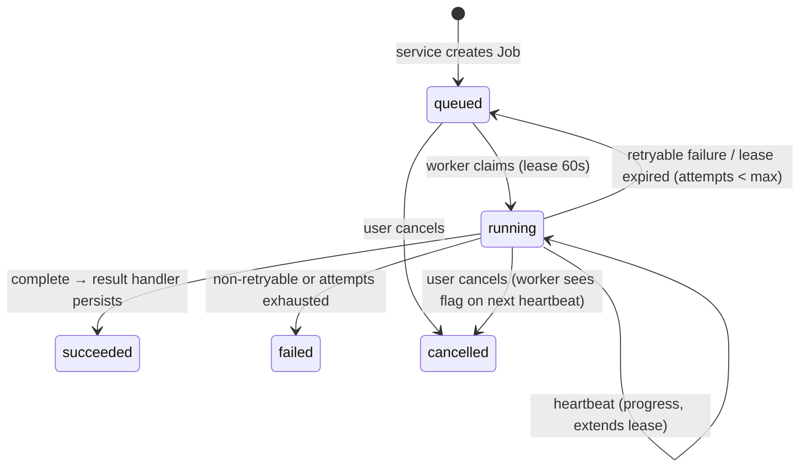
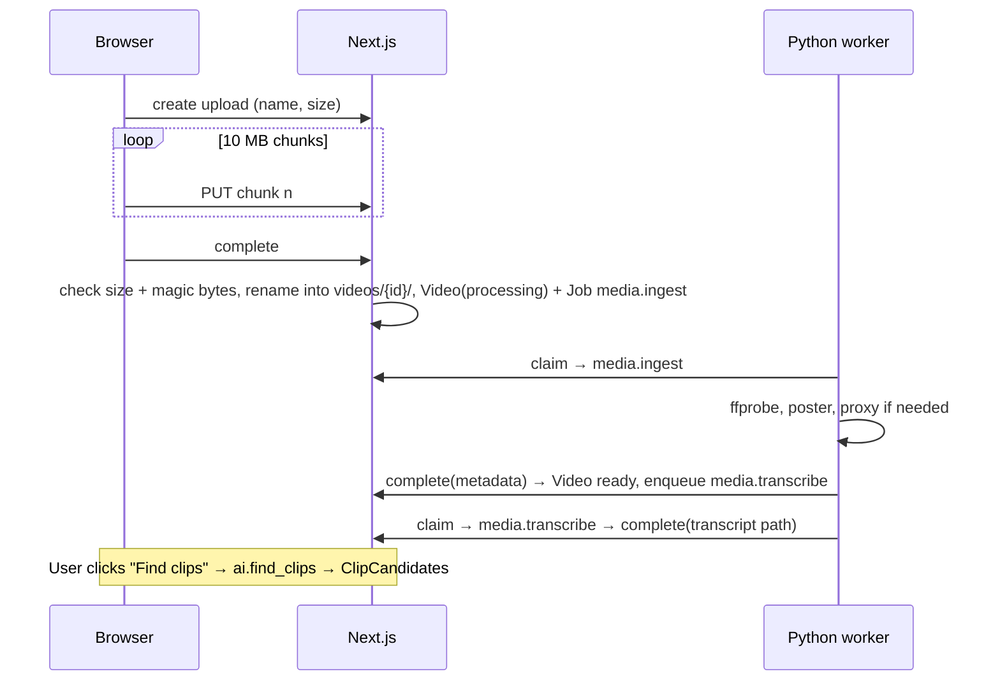

# Architecture

How the system is structured and how its parts work together. Technology details are in `TECHNICAL_SPEC.md`; reasons in `DECISIONS.md`.

## 1. System overview

Everything runs on the creator's computer. Three of our own processes, plus local tools and a few external APIs.



| Component | Responsibility | Never does |
|---|---|---|
| **Next.js app** (`src/app`, `src/server`) | Pages, auth, validation, business rules, DB writes, serving media, queuing jobs, persisting job results, OAuth flow | Long-running media/AI work inside a request |
| **Python media worker** (`media-worker/`) | Media and AI jobs (`media.*`, `ai.*`, `gen.*`) | Database access, handling OAuth tokens |
| **Node integration worker** (`src/worker/`, from Phase 7 — D-028) | YouTube jobs (`yt.*`), scheduled analytics sync | Serving HTTP |
| **SQLite** | All structured data, job queue | Storing media or secrets from `.env` |
| **storage/** | Media files, renders, caches | Being served directly (no static exposure) |

## 2. Repository layout (created from Phase 2 onwards)

```
/
├─ src/
│  ├─ app/
│  │  ├─ (auth)/login, (auth)/setup         first-run owner setup + login
│  │  ├─ (app)/dashboard, videos, clip-finder, shorts, packaging,
│  │  │        youtube, analytics, generator, settings/{channels,ai,system}
│  │  └─ api/
│  │     ├─ auth/[...all]                   Better Auth handler
│  │     ├─ uploads/[id]/{chunks/[index],complete}  chunked, resumable uploads
│  │     ├─ media/videos/[id]/[variant]      authenticated media streaming (Range)
│  │     ├─ media/shorts/[id]                exported Short (owner only, Range, ?download=1)
│  │     ├─ media/thumbnails/[id]            thumbnail image (owner only)
│  │     ├─ packaging/[kind]/[id]/thumbnails thumbnail upload (raw JPEG/PNG body, ≤ 10 MB)
│  │     ├─ jobs                             job list for the activity drawer
│  │     ├─ youtube/oauth/{start,callback}  channel connection (Google OAuth, PKCE + sealed state cookie)
│  │     ├─ internal/jobs/{claim,[id]/{heartbeat,complete,fail}}, internal/workers/heartbeat
│  │     │                                  worker API (secret-protected)
│  │     └─ health                          dependency status
│  ├─ components/ ui/ (shadcn, generated) · layout/ · states/ · auth/ · dashboard/ · settings/ · videos/
│  │               · clips/ · shorts/ (editor, 9:16 preview, timeline, captions, framing, export)
│  │               · packaging/ (workspace, version editor, thumbnails, copy button)
│  ├─ server/                               server-only code
│  │  ├─ env.ts  database-url.ts  db.ts  auth.ts  session.ts  auth-gate.ts  audit.ts
│  │  ├─ storage.ts  logger.ts  errors.ts  (crypto.ts arrives in Phase 7)
│  │  ├─ jobs/        queue.ts, handlers.ts, media-ingest.ts, media-transcribe.ts, ai-find-clips.ts,
│  │  │               queue-transcription.ts, media-reframe.ts, media-render-short.ts, ai-package.ts,
│  │  │               media-thumbnail.ts (one handler per job type)
│  │  ├─ shorts/      reframe-data.ts (stored face-tracking result schema)
│  │  ├─ transcripts/ transcript-file.ts (read/validate transcript JSON, snap ranges to words)
│  │  ├─ media/       sniff.ts (magic bytes), range.ts (HTTP Range), stream.ts (file responses)
│  │  ├─ http.ts, worker-auth.ts
│  │  ├─ services/    setup, sessions, system-status (Phase 2); uploads, videos, jobs (Phase 3);
│  │  │               transcripts, clips, ai-providers (Phase 4); shorts (Phase 5); packaging (Phase 6)
│  │  └─ youtube/     config.ts, oauth.ts (only reader of tokens), client.ts (REST), quota.ts, upload.ts
│  ├─ worker/index.ts                       Node integration worker: yt.upload (Phase 7, D-049)
│  ├─ proxy.ts                              optimistic auth redirect (Next.js 16 "proxy", formerly middleware)
│  ├─ lib/                                  navigation, app-config, auth-client, validation/ (zod), utils,
│  │                                        shorts/ (captions, caption-style, framing, range — shared by
│  │                                        the editor and the server; mirrored by the worker),
│  │                                        packaging/limits.ts (YouTube limits, hashtags)
│  └─ generated/prisma/                     Prisma client output (git-ignored)
├─ prisma/ schema.prisma, migrations/
├─ media-worker/
│  ├─ pyproject.toml, uv.lock
│  ├─ src/media_worker/ __main__.py, runner.py, api_client.py, config.py, storage.py, audio.py,
│  │                    ffmpeg.py, job_context.py, errors.py, jobs/<type>.py,
│  │                    transcription/ (provider interface + faster-whisper), llm/ (ollama, gemini,
│  │                    openai_compatible), clips/ (candidate windows, scoring, prompts),
│  │                    shorts/ (ass.py captions, framing.py filter graphs, tracking.py, face_model.py),
│  │                    packaging/ (source, chapters, checks, prompts, thumbnail)
│  ├─ assets/fonts/
│  └─ tests/
├─ tests/unit · tests/integration (Vitest) · tests/e2e (Playwright) · tests/support
├─ scripts/                                 create-env, reset-password (later: backup)
├─ data/      (git-ignored) SQLite file
└─ storage/   (git-ignored) media
```

Module rules:
- `src/app` imports from `src/server` and `src/lib`; never the reverse.
- `src/lib` is pure (no Node-only or server-only imports) so it can be used by client components.
- `src/worker` reuses `src/server/{db,crypto,storage,logger,youtube}` — those modules must not import Next.js APIs.
- Each feature's UI lives in `src/components/<feature>/` (e.g. `components/videos/`); its logic in `src/server/services/<feature>.ts`.

## 3. Job lifecycle



1. A service (e.g. `videos.finishUpload`) creates the domain record and a `Job` row in one transaction.
2. A worker calls `claim` with the types it supports; the app selects the oldest queued job by priority and updates it to `running` in a single SQL statement, so two workers can't claim the same job.
3. During work, the worker sends heartbeats with progress. The heartbeat response tells the worker if the job was cancelled.
4. On `complete`, the app validates the result with the job type's Zod schema, marks the job done **only if it is still running and held by that worker** (compare-and-set), and runs the type's **result handler** (e.g. insert `ClipCandidate` rows, set `Video.status = ready`) in the same transaction. A result the handler can't save fails the job (`RESULT_REJECTED`) instead of re-running it; a busy database lets the worker report again (it retries three times). Every other transition (fail, requeue, cancel, recovery) is also conditional on the state it expects (D-056).
5. A sweeper requeues jobs whose lease expired — this recovers from crashed workers. It runs on each claim, in the hourly housekeeping, and from the activity list (at most every 30 s), so a dead job is finished even when no worker runs.
6. "One active job per item" is checked inside the transaction that queues the job (`assertNoActiveJob`), so a double click can't queue two exports, renders or uploads.
7. The UI polls `GET /api/jobs?entity=...` every 2 s while anything is active; an activity tray in the top bar lists running jobs.

Job chaining (e.g. ingest → transcribe → find clips) is done by result handlers enqueueing the next job, so each step is retryable on its own.

## 4. Key flows

### 4.1 Upload to clips


### 4.2 Clip to published Short
1. User accepts a `ClipCandidate` → service creates a `Short` with captions built from the transcript and queues `media.reframe`.
2. User adjusts trim, captions, style and framing in the editor; each save updates the `Short`.
3. Export queues `media.render_short` → `Short.outputPath` set.
4. Packaging (`ai.package`) generates options; the user picks/edits title, description, tags and thumbnail.
5. Publish creates a `Publication` and queues `yt.upload` → Node worker decrypts the channel token, uploads, sets thumbnail, stores `youtubeVideoId`.

### 4.3 Channel connection
Browser → `/api/youtube/oauth/start` (creates `state` + PKCE verifier, stored in httpOnly cookie) → Google consent → `/api/youtube/oauth/callback` (verify state, exchange code, call `channels.list?mine=true`, encrypt tokens, upsert `YouTubeChannel` + `OAuthCredential`) → Settings › Channels. Details and protections: `SECURITY.md`.

### 4.4 Original video generation
`GeneratorProject` brief → `gen.script` → user edits and approves (D-054) → `gen.narrate` and, with a stock key, `gen.footage` (queued together; the single media worker runs them one after the other) → user reviews scenes, swaps footage (stock candidate, library video or uploaded clip via `POST /api/generator/scenes/{id}/footage`) → `gen.render` → new `Video` (`sourceType=generated`) + `media.ingest` → normal clip/packaging/publish flows. Scene audio, clips and music are streamed through authenticated routes under `/api/generator/`.

## 5. Cross-cutting concerns

- **Authentication:** `src/proxy.ts` redirects requests without a session cookie to `/login?next=…`; every page (`requireUser()`), server action and API handler (`requireApiSession()`) re-checks the session in `src/server/session.ts` (the proxy alone is not trusted). `/login` and `/setup` use `src/server/auth-gate.ts` to show a "configuration required" screen when settings are missing. See `SECURITY.md`.
- **Validation:** Zod at every boundary (forms, route handlers, server actions, worker results).
- **Errors:** services throw `AppError`; handlers map them to HTTP status + safe message; UI shows toasts and inline errors.
- **Health:** `/api/health` reports DB, storage write access, FFmpeg/ffprobe (+ libass), Ollama reachability and model, worker heartbeats, and which optional API keys are configured. Shown on Settings › System and as a warning banner on the dashboard.
- **Production run (Phase 10):** `npm run start:all` (or `scripts/start-windows.cmd`) starts `next start` on localhost plus the Python media worker and the Node worker (`--production`). `npm run dev:all` is the development equivalent.
- **Housekeeping (Phase 10, D-057):** the Node worker runs `src/server/maintenance.ts` at start and every `MAINTENANCE_INTERVAL_MIN`: lease recovery, abandoned uploads, files whose record is gone, unused generator files, stale stock cache.
- **Backups (Phase 10, D-058):** `npm run backup` / `npm run restore` (`scripts/backup.mjs`, `scripts/restore.mjs`, logic in `scripts/lib/backup.mjs`): online SQLite copy + storage without temporary files; restores move current data aside. Guide: DEPLOYMENT.md §5.
