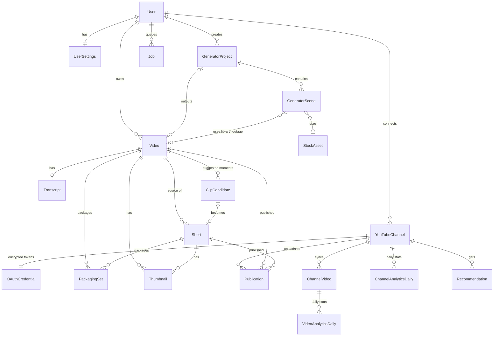

# Database Schema

Planned SQLite schema, implemented with Prisma (`prisma/schema.prisma`). Tables are added in the phase that needs them; this document is updated whenever a migration changes the schema.

**Implemented so far:**
- Phase 2 (migration `…_init`): `User`, `Session`, `Account`, `Verification`, `UserSettings` (Phase 2 columns only), `AuditLog`.
- Phase 3 (migration `…_video_library_and_jobs`): `Upload`, `Video`, `Job`, `WorkerHeartbeat`.
- Phase 4 (migration `…_transcripts_and_clip_candidates`): `Transcript`, `ClipCandidate`, and `UserSettings.autoTranscribe` / `llmProvider`.

Everything else below is still planned.

Database table names are lowercase snake_case via `@@map` (e.g. model `AuditLog` → table `audit_log`, `User` → `user`).

## Conventions

- IDs: `String @id @default(cuid())`.
- Every table has `createdAt DateTime @default(now())`; mutable tables also have `updatedAt DateTime @updatedAt`.
- Times are UTC. Durations are integer milliseconds (`...Ms`).
- Status/kind fields are `String` validated against unions in `src/lib/constants.ts` (SQLite has no native enums).
- JSON stored as `String` (SQLite) and parsed/validated with Zod on read; field names end in `Json`.
- File paths are **relative to `STORAGE_DIR`**.
- Ownership: every top-level record has `userId` (directly or via its parent); every query filters by the session user.
- Deleting a parent cascades to children (`onDelete: Cascade`) unless noted; files are removed by the service layer, not by the database.

## Entity overview

## Tables

### Authentication (Phase 2) — managed by Better Auth
Matches the schema produced by the Better Auth CLI (`npx auth generate`) for the Prisma adapter; do not rename fields. IDs are generated by Better Auth (no `@default`).

| Table | Key fields |
|---|---|
| `User` | `id`, `email` (unique), `name`, `emailVerified`, `image?` |
| `Session` | `id`, `userId` → User, `token` (unique), `expiresAt`, `ipAddress?`, `userAgent?` |
| `Account` | `id`, `userId` → User, `providerId` (`credential`), `password` (hashed by Better Auth) |
| `Verification` | `id`, `identifier`, `value`, `expiresAt` |

### `UserSettings` (Phase 2)
| Field | Type | Notes |
|---|---|---|
| `userId` | String, PK → User | 1:1, created automatically with the owner account (Phase 2) |
| `defaultLanguage` | String | default `auto` (detect) or a language code; used for transcription (Phase 4) |
| `defaultChannelId?` | String | channel preselected when publishing; set when the first channel is connected (Phase 7) ✅ |
| `autoTranscribe` | Boolean | default `true`; queue transcription after ingest when the video has audio (Phase 4) ✅ |
| `captionStyleJson?` | String | caption style for new Shorts (JSON, `src/lib/shorts/caption-style.ts`); null = built-in default (Phase 5) ✅ |
| `llmProvider` | String | `ollama` \| `gemini` \| `openai_compatible` \| `none` (speech patterns only); default `ollama` (Phase 4) ✅ |
| `channelStyleNotes?` | String | creator voice/tone guidance for packaging (Phase 6) ✅ |

### `OwnerLock` (Phase 10) ✅
`id` (always `"owner"`), `createdAt`. Inserted by the user-create hook when the owner account is created; the fixed primary key makes a second first-run sign-up fail even when two arrive at the same moment (D-059). Migration `20261014160829_owner_lock`. Table `owner_lock`.

### `AuditLog` (Phase 2)
`id`, `userId?` → User (`SetNull`), `action`, `detailsJson` (redacted, never secrets), `ipAddress?`, `createdAt`. Index: `(userId, createdAt)`.
Phase 2 actions: `auth.setup_completed`, `auth.login`, `auth.login_failed` (with the attempted email), `auth.password_changed`, `auth.session_revoked`. Later phases add e.g. `channel.connected`, `channel.disconnected`, `video.deleted`, `publication.uploaded`.

### `Job` (Phase 3) ✅
| Field | Type | Notes |
|---|---|---|
| `id` | String | cuid |
| `userId` | String → User | cascade |
| `type` | String | `media.ingest` so far — see `TECHNICAL_SPEC.md` §6 |
| `status` | String | `queued` \| `running` \| `succeeded` \| `failed` \| `cancelled` |
| `priority` | Int | lower runs first; default 100 |
| `payloadJson` / `resultJson?` | String | validated per type (Zod) |
| `progress` | Int | 0–100 |
| `progressMessage?` | String | shown in the UI |
| `entityType?` / `entityId?` | String | e.g. `video` + video ID (no FK; the job survives the video's deletion as history) |
| `attempts` / `maxAttempts` | Int | default 0 / 3; incremented on claim |
| `runAfter` | DateTime | not claimable before this (retry back-off) |
| `lockedBy?` / `leaseExpiresAt?` | String / DateTime | claim lease (60 s, extended by heartbeats) |
| `cancelRequested` | Boolean | the worker sees it on its next heartbeat |
| `error?` / `errorCode?` | String | user-safe message + machine code (e.g. `INVALID_VIDEO`, `CANCELLED`, `WORKER_LOST`) |
| `startedAt?` / `finishedAt?` | DateTime | |
Indexes: `(status, type, priority, createdAt)`, `(entityType, entityId)`, `(userId, createdAt)`. Table `job`.

### `WorkerHeartbeat` (Phase 3) ✅
`workerId` (PK), `kind` (`python` \| `node`), `version`, `capabilitiesJson` (e.g. FFmpeg version, job types), `lastSeenAt`. A worker not seen for 45 s counts as offline. Table `worker_heartbeat`.

### `Upload` (Phase 3) ✅
`id`, `userId` → User (cascade), `originalFilename` (display only, never a path), `extension` (validated, e.g. `mp4`), `totalBytes` (BigInt), `chunkSize`, `totalChunks`, `status` (`in_progress` \| `completed` \| `cancelled` \| `expired` \| `failed`), `error?`, `videoId?` → Video (unique, `SetNull`), `expiresAt` (24 h after the last chunk). Which chunks arrived is **not** stored in the database: `{index}.ok` marker files next to the data are the source of truth (DECISIONS.md D-029). Indexes: `(userId, status)`, `(status, expiresAt)`. Table `upload`.

### `Video` (Phase 3) ✅
| Field | Type | Notes |
|---|---|---|
| `id` | String | UUID generated when the upload completes |
| `userId` | String → User | cascade; every query filters by it |
| `title` | String | defaults to the file name without extension |
| `notes?` | String | creator notes used by packaging (Phase 6) |
| `sourceType` | String | `upload` \| `generated` (made by the Original Video Generator, Phase 9) |
| `creditsText?` | String | generated videos: stock and narration credits, appended to the description when publishing (D-055) |
| `status` | String | `processing` \| `ready` \| `failed` |
| `errorMessage?` | String | user-safe reason when failed |
| `originalFilename` | String | display only |
| `sourcePath` | String | `videos/{id}/source.{ext}` |
| `previewPath?` / `posterPath?` | String | set by `media.ingest` |
| `sizeBytes` | BigInt | |
| `durationMs?`, `width?`, `height?` | Int | from ffprobe (null until processed / when unknown) |
| `fps?` | Float | |
| `videoCodec?`, `audioCodec?` | String | `audioCodec` null = no audio track |
| `container` | String | from the validated extension |
| `processedAt?` | DateTime | |
Indexes: `(userId, createdAt)`, `(userId, status)`. Table `video`.

### `Transcript` (Phase 4) ✅
`id`, `videoId` (unique → Video, cascade), `status` (`processing` \| `ready` \| `failed`), `provider` (e.g. `faster-whisper`), `model?` (e.g. `base`), `language?`, `languageProbability?`, `filePath?` (`videos/{id}/transcript.json`, format in `TECHNICAL_SPEC.md` §7.2), `fullText?` (plain text for search and prompts), `wordCount`, `segmentCount`, `errorMessage?`, `completedAt?`. Table `transcript`.

### `ClipCandidate` (Phase 4) ✅
| Field | Type | Notes |
|---|---|---|
| `id` | String | cuid |
| `videoId` | String → Video | cascade; ownership is checked through the video |
| `startMs`, `endMs` | Int | always at transcript word boundaries (+ small padding) |
| `transcriptText` | String | the words inside the range (updated when the timing changes) |
| `score?` | Int | final 0–100 (70 % AI + 30 % speech patterns, or speech patterns alone); null for manual clips |
| `heuristicScore?` / `aiScore?` | Int | the parts; `aiScore` is null whenever no AI was used |
| `title`, `hook?`, `reason?` | String | from the AI, or derived from the text for non-AI clips |
| `category?` | String | `explanation` \| `surprising_fact` \| `story` \| `strong_reaction` \| `engaging_statement` \| `other` (AI only) |
| `origin` | String | `ai` \| `heuristic` \| `manual` |
| `status` | String | `suggested` \| `accepted` (Shorts Editor queue) \| `rejected` |
| `provider?`, `model?` | String | who rated it, e.g. `ollama` / `qwen2.5:1.5b` |
| `reviewedAt?` | DateTime | |
Indexes: `(videoId, score)`, `(videoId, status)`. Table `clip_candidate`.

### `Short` (Phase 5) ✅
Times are source-video milliseconds.

| Field | Type | Notes |
|---|---|---|
| `id`, `userId` | String | `userId` → User (`Cascade`) |
| `videoId` | String → Video | source (`Cascade`: deleting the video deletes its Shorts; the app removes their files) |
| `clipCandidateId?` | String → ClipCandidate | unique (one Short per clip), `SetNull` |
| `title` | String | working title (≤ 120) |
| `startMs`, `endMs` | Int | 1 s – 3 min long, inside the video |
| `reframeMode` | String | `auto` \| `center` \| `blur` \| `manual` (default `auto`; `center` for vertical sources) |
| `manualX` | Float | crop centre for `manual`, 0–1 of the source width (default 0.5) |
| `reframeStatus` | String | face tracking: `none` \| `processing` \| `ready` \| `failed` |
| `reframeError?` | String | user-safe reason when face tracking failed |
| `reframeJson?` | String | `media.reframe` result: `{startMs, endMs, model, keyframes: [{tMs, x}], shots, shotsWithFace, faceSamples, samples, warnings}` (analysed range = Short ± 10 s) |
| `captionsEnabled` | Boolean | default `true` (`false` when there is no transcript) |
| `captionsJson` | String | `[{startMs, endMs, text}]`, editable, normalised (sorted, no overlaps, inside the range) |
| `captionStyleJson` | String | preset + font, size, colours, background, opacity, position, capitals |
| `hookText?` | String | optional text at the top for the first 3 s (SHORT-08) |
| `exportQuality` | String | `standard` \| `high` |
| `status` | String | export: `draft` \| `rendering` \| `ready` \| `failed` |
| `renderError?` | String | user-safe reason when the last export failed |
| `outputPath?`, `outputSizeBytes?`, `outputDurationMs?` | String / BigInt / Int | `shorts/{id}/render-{n}.mp4` |
| `renderSignature?` | String | SHA-256 of the exported settings; differs from the current settings → "out of date" (SHORT-07) |
| `renderElapsedMs?`, `renderedAt?` | Int / DateTime | how long the last export took, when it finished |
| `createdAt`, `updatedAt` | DateTime | |

Indexes: `(userId, updatedAt)`, `(videoId)`. Migration `20261014094410_shorts`.

### `Thumbnail` (Phase 6) ✅
| Field | Type | Notes |
|---|---|---|
| `id`, `userId` | String | `userId` → User (`Cascade`) |
| `videoId?` / `shortId?` | String → Video / Short | exactly one is set (`Cascade`; the app deletes the files) |
| `packagingSetId?` | String → PackagingSet | the version it was made from (`SetNull`) |
| `origin` | String | `frame` \| `mockup` \| `upload` — never an AI-generated image |
| `status` | String | `processing` \| `ready` \| `failed`; `error?` user-safe reason |
| `filePath?` | String | `thumbnails/{id}.jpg` |
| `width`, `height`, `sizeBytes?` | Int | 1280×720 (videos) or 720×1280 (Shorts); < 2 MB |
| `sourceFrameMs?`, `headline?` | Int / String | frame time in the source video; text drawn on a mock-up |
| `selected` | Boolean | the creator's chosen thumbnail for the video/Short (one per target) |
| `createdAt`, `updatedAt` | DateTime | |

### `PackagingSet` (Phase 6) ✅
| Field | Type | Notes |
|---|---|---|
| `id`, `userId` | String | |
| `videoId?` / `shortId?` | String → Video / Short | exactly one is set (`Cascade`) |
| `status` | String | `processing` \| `ready` \| `failed`; `error?` |
| `inputNotes?` | String | the creator's notes for this version |
| `provider?`, `model?` | String | who wrote it, e.g. `ollama` / `qwen2.5:1.5b` |
| `titlesJson`, `hooksJson` | String | `[{text, flags[], edited}]` — editable |
| `description` | String | editable, ≤ 5,000 bytes, chapters included |
| `hashtagsJson` | String | `[{tag, selected}]` |
| `thumbnailConceptsJson` | String | `[{headline, composition, emotion, frameMs, flags[]}]` |
| `chaptersJson`, `warningsJson` | String | `[{startMs, title}]`; notices (summarised, dropped hashtags, …) |
| `generatedJson?` | String | the generated version, to tell edits from AI text |
| `selectedTitle`, `selectedHook` | Int | chosen options |
| `preferred` | Boolean | "Use this packaging" — at most one per target |
| `savedAt?`, `createdAt`, `updatedAt` | DateTime | |

Multiple sets per target are kept so the user can compare regenerations. Migration `20261014112908_packaging`.

### `YouTubeChannel` (Phase 7) ✅
`id`, `userId` → User, `youtubeChannelId` (unique), `title`, `handle?`, `thumbnailUrl?` (only YouTube image hosts), `uploadsPlaylistId?`, `status` (`active` \| `reauth_required` \| `revoked`), `grantedScopes` (space-separated), `connectedAt`, `lastSyncedAt?`. Disconnecting keeps the row as `revoked` (upload history) and deletes its `OAuthCredential`.

### `OAuthCredential` (Phase 7) ✅
| Field | Type | Notes |
|---|---|---|
| `channelId` | String, PK → YouTubeChannel | 1:1, cascade |
| `accessTokenEnc` | String | `v1:<iv>:<authTag>:<ciphertext>` base64, AES-256-GCM |
| `refreshTokenEnc` | String | same format |
| `accessTokenExpiresAt` | DateTime | refreshed 60 s before |
| `keyVersion` | Int | supports key rotation (currently 1) |
| `updatedAt` | DateTime | |
Only `src/server/youtube/oauth.ts` reads or writes it.

### `Publication` (Phase 7) ✅
| Field | Type | Notes |
|---|---|---|
| `id`, `userId` | String | |
| `channelId` | String → YouTubeChannel | cascade |
| `videoId?` / `shortId?` | String | exactly one set (`SetNull`, so history survives deletes) |
| `thumbnailId?` | String → Thumbnail | `SetNull` |
| `sourceTitle`, `filePath` | String | what was uploaded |
| `title`, `description` | String | final metadata |
| `tagsJson`, `categoryId` | String | |
| `privacyStatus` | String | requested: `private` \| `unlisted` \| `public` |
| `actualPrivacyStatus?` | String | what YouTube reported after upload (D-048) |
| `publishAt?` | DateTime | always sent with `private` |
| `madeForKids`, `containsSyntheticMedia` | Boolean | required answers |
| `status` | String | `queued` \| `uploading` \| `uploaded` \| `scheduled` \| `failed` \| `cancelled` |
| `uploadProgress`, `bytesUploaded` | Int / BigInt | |
| `uploadSessionEnc?` | String | encrypted resumable session URI (cleared when done) |
| `youtubeVideoId?`, `error?`, `warningsJson`, `uploadedAt?` | | |

### `ApiQuotaUsage` (Phase 7) ✅
`id`, `projectDate` (YYYY-MM-DD in Pacific time, when YouTube quota resets), `bucket` (`default` \| `videos.insert`; `search.list` \| `analytics` later), `units` (Int, incremented with a conditional update so the limit is never passed). Unique: `(projectDate, bucket)`. Migration `20261014130926_youtube` (also adds `UserSettings.defaultChannelId`).

### `ChannelVideo` (Phase 8) — videos on YouTube, including ones not uploaded by the app
`id`, `channelId` → YouTubeChannel, `youtubeVideoId` (unique), `title`, `publishedAt`, `durationMs`, `isShortGuess` (vertical/≤3 min heuristic, labelled as a guess), `thumbnailUrl?`, `viewCount`, `likeCount`, `commentCount`, `lastSyncedAt`, `publicationId?` → Publication (`SetNull`).

### `ChannelAnalyticsDaily` (Phase 8)
`id`, `channelId`, `date` (Date), `views`, `estimatedMinutesWatched`, `averageViewDurationSec`, `subscribersGained`, `subscribersLost`, `likes`, `comments`, `shares`. Unique: `(channelId, date)`.

### `VideoAnalyticsDaily` (Phase 8)
`id`, `channelVideoId` → ChannelVideo, `date`, `views`, `estimatedMinutesWatched`, `averageViewDurationSec`, `averageViewPercentage?`, `likes`, `comments`, `shares`, `subscribersGained`. Unique: `(channelVideoId, date)`.

### `Recommendation` (Phase 8)
`id`, `channelId`, `ruleKey` (e.g. `posting_gap`), `title`, `body`, `evidenceJson`, `priority`, `dismissedAt?`, `createdAt`. Regenerated after each analytics sync; dismissed rule keys stay dismissed for 30 days.

### `GeneratorProject` (Phase 9) ✅
`id`, `userId` → User (cascade), brief: `topic`, `niche` (id from `GENERATOR_NICHES`), `audience?`, `tone`, `notes?`, `targetDurationSec`, `aspectRatio` (`16:9` \| `9:16`), `resolution` (720 \| 1080, short side), `language` (`English`), `voice?` (null = engine default), `voiceRate` (-5…5), `captionsEnabled`, `quality` (`standard` \| `high`); state: `status` (`draft` \| `scripting` \| `editing` \| `rendering` \| `ready`), `error?` (last script/render failure); script: `title?`, `hook?`, `scriptProvider?`, `scriptModel?`, `scriptWarningsJson`, `scriptApprovedAt?` (D-054); `musicPath?` (`generator/{id}/music-*`), `musicVolumeDb` (default -18); output: `outputVideoId?` → Video (unique, `SetNull` — the latest render), `creditsText?`, `renderElapsedMs?`, `renderedAt?`. Index `(userId, updatedAt)`. Table `generator_project`.

### `GeneratorScene` (Phase 9) ✅
`id`, `projectId` → GeneratorProject (cascade), `order` (0-based, rewritten on save — so not unique-constrained), `narration`, `visualQuery`, `onScreenText?`, `estimatedMs?`; narration: `narrationStatus` (`none` \| `processing` \| `ready` \| `failed`), `narrationError?`, `audioPath?`, `audioDurationMs?`, `wordTimingsJson?` (`[[startMs, endMs, word]]`), `timingSource?` (`engine` \| `estimated`), `narratedText?` (differs from `narration` → out of date); footage: `footageSource?` (`stock` \| `library` \| `upload`), `footageStatus` (`none` \| `searching` \| `ready` \| `failed`), `footageError?`, `stockAssetId?` → StockAsset (`SetNull`), `candidatesJson` (up to 5 stock candidates), `libraryVideoId?` → Video (`SetNull`), `customClipPath?`, `clipStartMs`. Index `(projectId, order)`. Table `generator_scene`.

### `StockAsset` (Phase 9) ✅
`id`, `provider` (`pexels` \| `pixabay`), `providerAssetId`, `pageUrl`, `creatorName`, `creatorUrl?`, `downloadUrl` (official media host only), `previewImageUrl?`, `filePath` (`stock-cache/{provider}/{providerAssetId}.mp4`), `width`, `height`, `durationMs`, `licenseName`, `downloadedAt?` (null until the file is in the cache), `createdAt`. Unique: `(provider, providerAssetId)`. Shared cache across projects. Table `stock_asset`.

Migrations `20261014143043_generator` and `20261014144658_generated_video_credits` (adds `Video.creditsText`).
